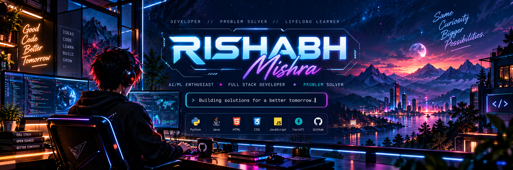

<!--
  Rishabh Mishra — Profile README v1.2
  GitHub account: https://github.com/rishabhmishra8433736-sys
  Upload README.md, head.png, assets/, and .github/ at the root of the profile repository.
  All visuals are static GitHub-compatible assets or normal image embeds.
  The generated contribution snake is intentionally not shown until activated.
-->

<h2 align="center">Hi, I'm Rishabh Mishra </h2>

  <strong>Computer Science (AI) Student · Software Developer · AI/ML Enthusiast</strong>

  

  
  &nbsp;
  
  &nbsp;
  

  <a href="#-about-me">About</a> &nbsp;·&nbsp;
  <a href="#-featured-projects">Projects</a> &nbsp;·&nbsp;
  <a href="#-tech-stack">Tech Stack</a> &nbsp;·&nbsp;
  <a href="#-github-at-a-glance">At a Glance</a> &nbsp;·&nbsp;
  <a href="#-connect">Connect</a>

## ◈ About Me
I'm Rishabh Mishra, a B.Tech Computer Science (Artificial Intelligence) student who enjoys turning real-world challenges into practical software. I work across web development, data systems, and AI/ML, with a particular interest in intelligent applications and predictive technology.
- Build: Responsive applications and backend-enabled products
- Explore: Artificial intelligence, machine learning, and data visualization
- Engineer: Database-backed systems, caching, streaming, and containerized workflows
- Practice: Java, Python, algorithms, and problem-solving
## ◈ Featured Projects
Aeropulse-IQ
An AI-focused air-pollution monitoring project exploring air-quality insights, location-based data, analytics, and prediction through a web dashboard.

Focus: Environmental technology · Web dashboards · Data insights

View repository →
 KISAN-QUEUE
A smart agricultural-procurement platform concept supporting farmer registration, queue management, transport coordination, and transparent market operations.

Focus: Agricultural technology · Procurement workflows · Transport coordination

View repository →
 PRATIRUP
Predictive Real-time Analytics & Twin for Intelligent Reliability & UAV Propulsion. A digital-twin project concept focused on engine-health monitoring, anomaly detection, and predictive maintenance.

Focus: Digital twins · Predictive analytics · Reliability engineering

Repository created; public source and documentation have not yet been published.

View repository →
## ◈ Tech Stack

<em>The languages and tools I use or am learning across my projects.</em>

Web Development & Programming

  
  &nbsp;&nbsp;
  
  &nbsp;&nbsp;
  
  &nbsp;&nbsp;
  
  &nbsp;&nbsp;
  

HTML5 · CSS3 · JavaScript · Java · Python

Streaming, Containers & DevOps

  
  &nbsp;&nbsp;
  

Apache Kafka · Docker · Docker Compose

Databases & Caching

  
  &nbsp;&nbsp;
  
  &nbsp;&nbsp;
  

MongoDB · PostgreSQL · Redis

AI, Machine Learning & Data

  
  &nbsp;&nbsp;
  
  &nbsp;&nbsp;
  
  &nbsp;&nbsp;
  

PyTorch · Pandas · Matplotlib · Scikit-learn

Design & Collaboration

  
  &nbsp;&nbsp;
  

Canva · GitHub

## ◈ GitHub at a Glance

  
  &nbsp;
  
  &nbsp;
  

A quick look at what I'm building, learning, and sharing. 
Focus	What you'll find
 Featured projects	Aeropulse-IQ · KISAN-QUEUE · PRATIRUP
 AI & data	Predictive systems, digital twins, PyTorch, Pandas, and data visualization
 Engineering	Java, Python, web development, Kafka, Docker, databases, and caching
 Current focus	DSA, machine learning, system design, and shipping stronger project demos

Explore my activity: All repositories · Contributions · Starred repositories · LeetCode

  
<strong> View live GitHub statistics</strong>

   
  

    
  

  

    
  

  
Live cards are provided by external services.

<!-- Contribution snake workflow: .github/workflows/contribution-snake.yml -->

### ◈ Contribution Analytics

  

  

  

### ◈ Contribution Snake

  

The snake appears after the contribution-snake GitHub Actions workflow succeeds for the first time.

## ◈ What I'm Focused On
- Problem-solving: Stronger DSA fundamentals and clear, efficient code
- AI/ML: Designing, evaluating, and understanding predictive models
- Software engineering: Building reliable applications from UI to backend
- Systems: Learning how Kafka, Docker, PostgreSQL, MongoDB, and Redis fit together
## ◈ Connect With Me

  
  &nbsp;
  
  &nbsp;
  

  
  &nbsp;
  

Building with curiosity. Improving with every commit.

<!-- Only the footer has blinking stars. Keep this as the final visual. -->

  

